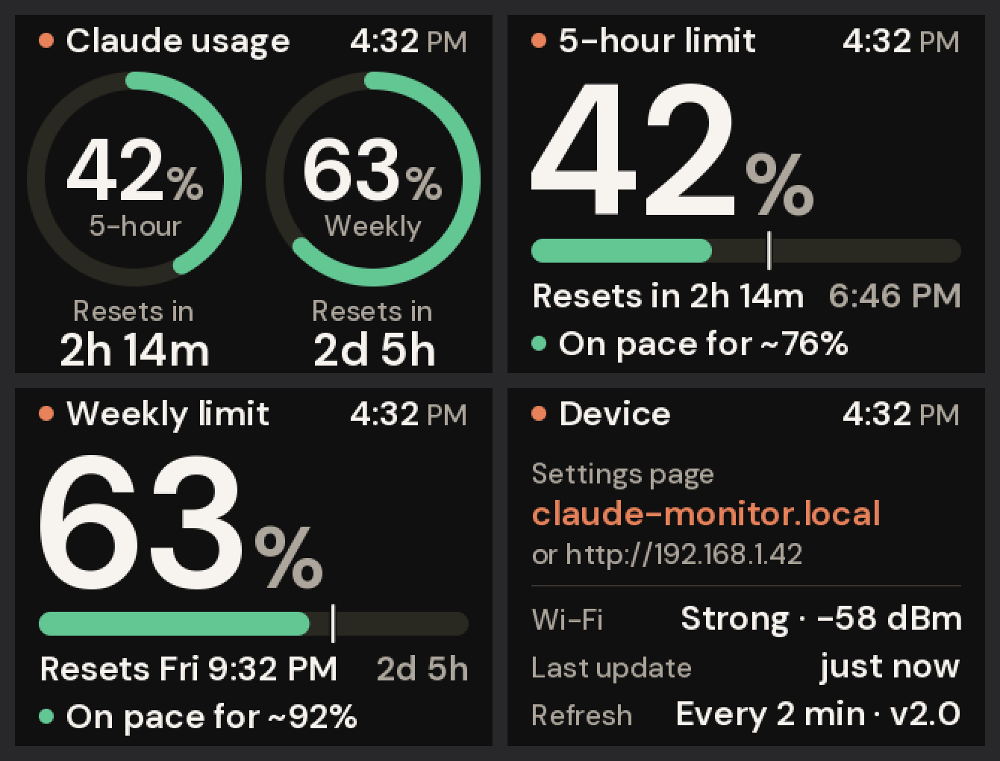

# Claude Usage Monitor v2 (CYD)

A redesign of [Nisanth Nimashakavi's Claude-Monitor](https://github.com/Nisanth-Nimashakavi/Claude-Monitor)
firmware for the ESP32-2432S028R "Cheap Yellow Display": large, smooth text,
a calmer modern look, and a few new features. It reads usage the same way v1
does. The v1 sketch is still in `../CYD_ClaudeUsage/`.



*(Images rendered by the Mac simulator in `sim/`. It runs the same drawing
code as the device.)*

## What's different from v1

| | v1 | v2 |
|---|---|---|
| Text | 5×7 pixel font, scaled up (8–24 px, blocky) | DM Sans, anti-aliased, 19–124 px |
| Main numbers | 24 px | 58 px (overview), 124 px (detail pages) |
| Look | Retro terminal | Dark warm charcoal, rounded gauges, color by status |
| Pages | 1 | 4: Overview · 5-hour · Weekly · Device (tap to switch) |
| Clock | – | Time of day in the header, reset times in your time zone |
| Pace | – | "On pace for ~76%" or "Runs out in ~50m" |
| Settings | Factory reset + re-enter everything | Web page on your network, no reset needed |
| Night | – | Optional dim/off schedule; tap to wake |
| TLS | GlobalSign root (expires Jan 2028) | + GTS Root R1/R4 (valid to 2036) |

Upgrading keeps your saved Wi-Fi and token, so you don't need to set it up again.

## Pages

Tap the screen to go to the next page.

1. **Overview**: two rings for the 5-hour and weekly limits, with the time
   until each one resets.
2. **5-hour**: one giant number, a bar, the local reset time and a pace line.
3. **Weekly**: the same for the weekly limit.
4. **Device**: settings address, IP, Wi-Fi signal, last update, version.

**Colors:** green = fine. Amber = 75% or more, *or* at your current rate
you'll hit the limit before it resets. Red = 90% or more, or limited.

**Pace:** the white tick on the detail-page bar marks how much of the
window's *time* has passed. If the colored fill is past the tick, you're
using it faster than an even pace. The pace line projects your average rate
so far to the reset time. It waits until 15% of the window has gone by,
because early numbers jump around.

## Controls

| Action | Result |
|---|---|
| Tap screen | Next page (if the screen is off, wakes it for 30 s) |
| Press & hold screen 1 s | Refresh now |
| Tap BOOT | Brightness: off → dim → normal → bright (remembered) |
| Hold BOOT 5 s | Factory reset: clears Wi-Fi and token, back to setup |

The old GPIO35 "refresh" button is gone. On a stock CYD that pin has no
button or pull-up, so it could trigger refreshes at random. Hold the screen
to refresh instead.

## Settings page

While the monitor is running, open **http://claude-monitor.local** (or
`http://<IP shown on the Device page>`) on any phone or computer on the same
Wi-Fi. You can set:

- **Time zone**, picked from your browser automatically (press Save once)
- 12- or 24-hour clock
- Brightness, plus a night schedule (dim or off between two hours)
- Which page to show first, and whether to cycle pages when idle
- How often to check usage (30 s to 10 min)

The page also shows your current usage and has a "Refresh now" button. It
never shows or sends the token. Wi-Fi and token changes still go through the
BOOT-button factory reset.

## Flashing

**Arduino IDE:** same as v1. Install the ESP32 boards package and the
**TFT_eSPI** library, copy `User_Setup.h` into the TFT_eSPI folder, open this
folder, select **ESP32 Dev Module** and **Partition Scheme → Huge APP (3MB No
OTA)**, then Upload. (ArduinoJson is no longer needed.)

**Terminal (arduino-cli):**
```bash
sh flash.sh
```
This compiles, uploads to the first USB serial port it finds, and then shows
the serial log. You can name the port instead: `sh flash.sh /dev/cu.usbserial-10`.
It uploads at 115200 baud because this board stops responding at the faster
default (about 80 seconds per upload). In the Arduino IDE, set **Tools → Upload
Speed → 115200** for the same reason.

## Changing the look

- `screens.cpp`: all layouts and the color palette (`namespace pal`).
- `tools/make_fonts.py`: regenerates `fonts.h` (typeface and sizes). Needs
  Pillow: `python3 -m pip install pillow`.
- `sim/build.sh`: renders every screen to `sim/out/*.png` on a Mac in a few
  seconds, so you can check a change before flashing.

## Files

```
CYD_ClaudeUsage_v2.ino  setup/loop, buttons, touch, Wi-Fi, night mode, settings
api.ino                 usage probe + rate-limit header parsing, trusted roots
display.ino             band renderer → panel (flicker-free full redraws)
provision.ino           first-time setup access point + portal
settings_web.ino        settings page + JSON API on your network
crypto.ino              token obfuscation (unchanged from v1)
gfx.h / gfx.cpp         anti-aliased drawing (rings, bars, text), no Arduino deps
screens.h / screens.cpp every screen's layout, from one Model struct
fonts.h                 generated DM Sans glyphs (~160 KB, in flash)
web_assets.h            HTML/CSS/JS for the two web pages
User_Setup.h            TFT_eSPI pins for the CYD (unchanged)
sim/                    Mac preview simulator
tools/make_fonts.py     font generator
```

DM Sans is licensed under the SIL Open Font License 1.1.
